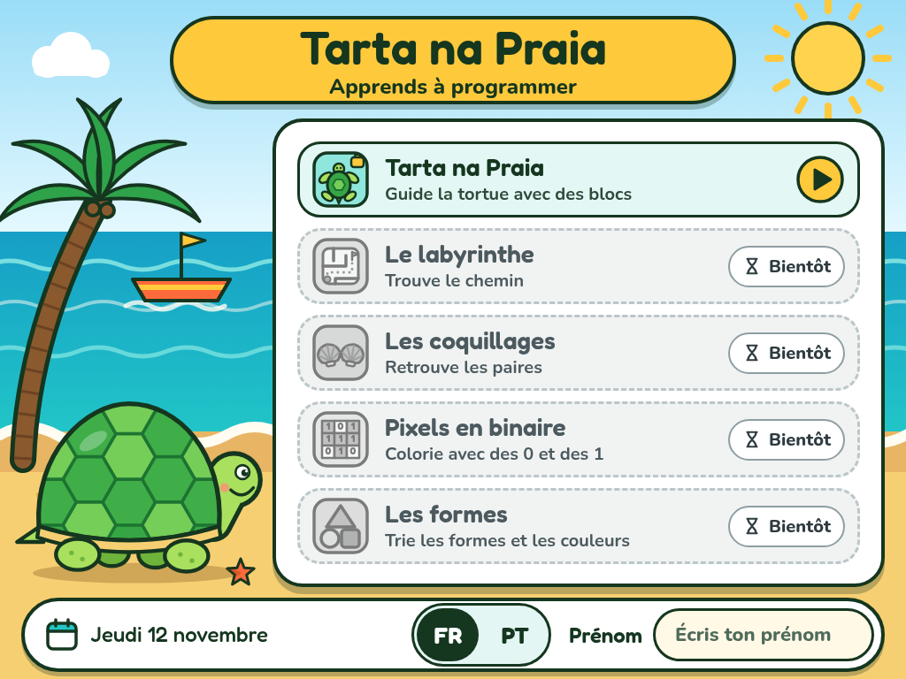
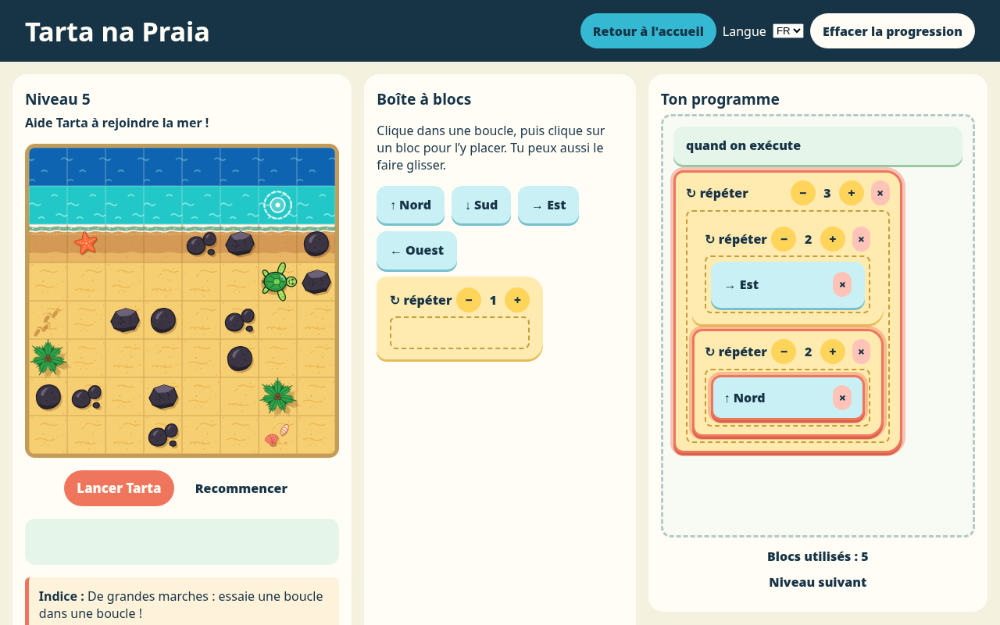
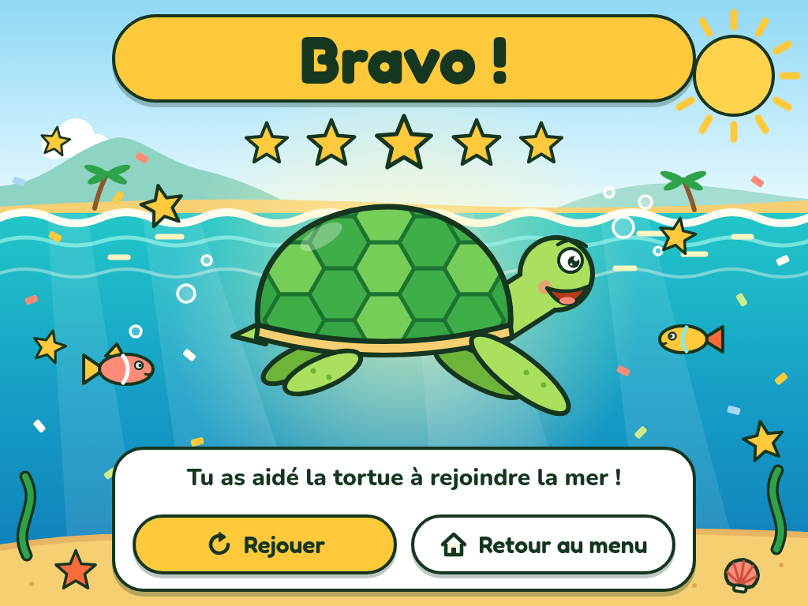

# Tarta na Praia

Logiciel éducatif de programmation par blocs pour les enfants capverdiens de 5 à 11 ans. Tarta, la tortue, doit rejoindre la mer : l'enfant assemble des blocs de direction et des boucles pour la guider à travers la plage.

Le logiciel fonctionne **entièrement hors ligne**, en français et en portugais, et tourne dans un simple navigateur, y compris sur de vieux PC d'école.

## Démarrer

1. Copiez le dossier, par exemple sur une clé USB.
2. Ouvrez `index.html` par double-clic dans un navigateur (Firefox, Chrome, Edge…).

Il n'y a rien à installer : aucune connexion Internet, aucun serveur, aucune dépendance. Les polices sont fournies dans `polices/`.

Pour développer, on peut aussi servir le dossier avec `python3 -m http.server`, puis ouvrir <http://localhost:8000>.

## Parcours de l'enfant

1. **Lanceur** (`index.html`) : l'enfant choisit sa langue (FR | PT), écrit son prénom et lance une activité. Seule l'activité Tarta na Praia est disponible pour l'instant ; les quatre autres sont affichées « Bientôt ».
2. **Jeu** (`tarta.html`) : cinq niveaux. Quand un niveau est réussi, Tarta plonge dans la mer et le niveau suivant s'affiche tout seul.
3. **Victoire** (`victoire.html`) : après le niveau 5. « Rejouer » relance le niveau 1, « Retour au menu » revient au lanceur, où l'activité est alors marquée « Terminé ».

### Les cinq niveaux

Chaque niveau introduit une nouvelle notion de programmation.

| Niveau | Notion | Solution courte |
|---|---|---|
| 1 | Une boucle | répéter 6 × Nord |
| 2 | Deux boucles (chemin en L) | répéter 5 × Est, puis 6 × Nord |
| 3 | Plusieurs blocs dans une boucle (escalier) | répéter 6 × [Est, Nord] |
| 4 | Contourner un obstacle (mur de rochers) | 5 × Ouest, 4 × Nord, 5 × Est, 2 × Nord |
| 5 | Une boucle dans une boucle (grand escalier) | répéter 3 × [2 × Est, 2 × Nord] |

Le nombre de blocs n'est pas limité : un enfant peut aussi réussir en posant les blocs un par un.

### Comment jouer

- Cliquez sur un bloc de la **Boîte à blocs** pour l'ajouter au programme, ou faites-le glisser.
- Pour remplir une boucle, cliquez d'abord dans son cadre en pointillés, puis sur les blocs à y mettre. Les boutons − et + règlent le nombre de répétitions.
- **Lancer Tarta** exécute le programme bloc par bloc, en surlignant le bloc en cours. Les rochers, les palmiers et les étoiles de mer bloquent Tarta.

## Organisation des fichiers

| Fichier ou dossier | Rôle |
|---|---|
| `index.html` | Lanceur : écran d'accueil des activités. |
| `lanceur/` | Style (`lanceur.css`), textes FR/PT (`textes.js`), décor, tortue, icônes, ligne d'activité et barre du bas (`composants.js`), logique (`lanceur.js`). |
| `tarta.html` | Le jeu, complet et autonome : HTML, CSS, JavaScript, textes FR/PT et visuels de la grille (sprites SVG intégrés). |
| `victoire.html` | Écran de victoire. |
| `victoire/` | Style (`victoire.css`), étoiles et icônes des boutons (`composants.js`), logique (`victoire.js`). |
| `images/victoire-A.svg` | Illustration de fond de l'écran de victoire. À utiliser telle quelle. |
| `polices/` | Fredoka et Nunito (woff2, sous-ensemble latin) et leurs licences OFL. |
| `verifier_langues.js` | Vérifie que chaque langue contient toutes les clés de texte. |
| `docs/` | Captures d'écran de ce README. |

Le code est en HTML, CSS et JavaScript simples, sans framework ni étape de compilation. Les scripts sont classiques (pas de modules ES), car les modules sont bloqués quand on ouvre une page par double-clic (`file://`).

Le lanceur et l'écran de victoire sont conçus en 1024 × 768 et mis à l'échelle pour remplir la fenêtre, à la manière d'une diapositive.

## Ajouter un niveau

1. Ouvrez `tarta.html` et ajoutez un objet à la fin du tableau `NIVEAUX`, en vous inspirant des niveaux existants.
2. Renseignez ses champs :

   | Champ | Contenu |
   |---|---|
   | `id` | Identifiant, par exemple `"niveau-6"`. |
   | `grille` | 8 chaînes de 8 caractères : `.` sable, `S` départ, `M` case du but, `#` rocher. |
   | `terrain` | 8 lignes de 8 valeurs pour le sol : `"eau-profonde"`, `"eau"`, `"objectif"`, `"sable-mouille"` ou `"sable"`. |
   | `objets` | Liste de `[ligne, colonne, "nom"]`. Obstacles : `rocher-1`, `rocher-2`, `rocher-3`, `palmier`, `etoile-de-mer`. Décor sans effet : `coquillages`, `traces-pas`. |
   | `depart`, `but` | Positions `{ligne, colonne}`, la ligne 0 étant en haut. |
   | `titre`, `indice` | Clés de texte, par exemple `"niveau_6"` et `"indice_niveau_6"`. |
   | `maxBlocs` | Facultatif : limite le nombre de blocs du programme. |

3. Ajoutez les textes `niveau_6` et `indice_niveau_6` dans `TEXTES.fr` **et** dans `TEXTES.pt`, puis lancez `node verifier_langues.js`.

Le niveau s'enchaîne automatiquement après le précédent. L'écran de victoire s'affiche toujours après le **dernier** niveau du tableau.

## Ajouter une langue

1. Copiez le bloc `fr` de `TEXTES` (dans `tarta.html`) et de `TEXTES_LANCEUR` (dans `lanceur/textes.js`), et renommez-le, par exemple `kea`.
2. Traduisez toutes les valeurs sans modifier les clés. `code_html` donne la langue de la page (par exemple `"pt-PT"`) ; dans le lanceur, `locale` règle aussi le format de la date.
3. Lancez `node verifier_langues.js` pour vérifier que toutes les clés françaises existent dans la nouvelle langue.

Les sélecteurs de langue se construisent automatiquement. Le lanceur, le jeu et l'écran de victoire partagent la langue choisie.

Dans `lanceur/textes.js`, les textes français mettent une espace insécable (écrite `\u00a0`) avant « ! », pour que la ponctuation ne passe jamais seule à la ligne. Les textes du jeu ne le font pas encore.

## Brancher une nouvelle activité

Les activités 2 à 5 du lanceur (labyrinthe, coquillages, pixels en binaire, formes) sont prévues mais pas encore réalisées. Quand l'une d'elles existe :

1. placez sa page à la racine, par exemple `labyrinthe.html` ;
2. dans `lanceur/lanceur.js`, indiquez son chemin dans le champ `page` de son entrée du tableau `ACTIVITES`.

Le bouton devient alors actif, avec la pastille ▶ à la place de « Bientôt ». Si l'activité enregistre `serie_terminee: true` dans une clé de stockage, indiquez cette clé dans `progression` : le lanceur affichera « Terminé ».

## Données enregistrées

Tout reste dans le navigateur de l'ordinateur (`localStorage`). Rien n'est envoyé nulle part.

| Clé | Contenu |
|---|---|
| `tarta-na-praia-langue` | Langue choisie (`fr` ou `pt`). |
| `tarta-na-praia-prenom` | Prénom écrit dans le lanceur. |
| `tarta-na-praia-progression` | Niveaux réussis et `serie_terminee`. Effacée par « Rejouer » et par « Effacer la progression ». |

Si le stockage est bloqué (navigation privée, réglages de l'école…), tout fonctionne quand même : seuls les choix ne sont pas retenus.

## Accessibilité et performance

- Navigation complète au clavier, avec un anneau de focus bien visible.
- Vrais boutons et vrais champs, textes alternatifs, et `<html lang>` qui suit la langue choisie.
- Contraste des textes d'au moins 4,5:1 et zones cliquables d'au moins 60 px de haut dans le lanceur et l'écran de victoire.
- Les animations (vagues, survols, déplacements) s'arrêtent si l'ordinateur demande moins de mouvement.
- Pas de bibliothèque, pas de filtre coûteux : le logiciel reste fluide sur du matériel ancien.

## Crédits

- Visuels de la plage, du lanceur et de l'écran de victoire réalisés avec Claude Design.
- Polices [Fredoka](https://github.com/hafontia/Fredoka-One) et [Nunito](https://github.com/googlefonts/nunito), sous licence SIL Open Font License 1.1 (voir `polices/`).
